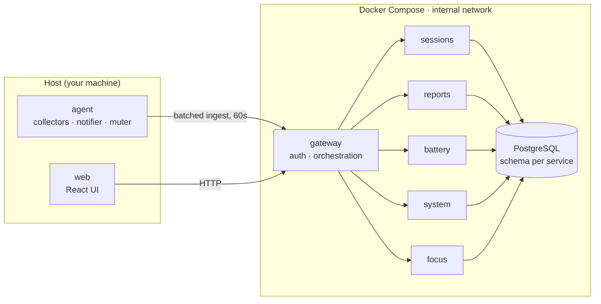

# DeskPulse

**A calm control center for your Linux desktop. Local only.**

DeskPulse shows how your computer is doing at a glance and helps you keep it that way: live load,
memory, disk and battery, why it slowed down and which app was to blame, a task manager, disk
cleanup, pending updates, startup apps, where your time went, and a focus mode that holds
notifications until you're done. Every page is a grid of widgets you can arrange, in Hebrew or
English, light or dark, with ten color palettes. Nothing ever leaves your computer.

> **Status:** in development. The services, the agent, the gateway and the first web pages exist.
> Wave 4 builds on them: the new design, the control center features and the Tauri desktop app.
> See [docs/TASKS.md](docs/TASKS.md).

## Features (planned)

| Area            | What it does                                                                                                                                                                                                                          |
| --------------- | ------------------------------------------------------------------------------------------------------------------------------------------------------------------------------------------------------------------------------------- |
| **Control**     | Live CPU, memory, disk, network and battery; internet state and uptime; a "needs attention" list that links to the fix.                                                                                                               |
| **Performance** | Detects real stalls with Linux [PSI](https://docs.kernel.org/accounting/psi.html), explains them in plain words with the app to blame, and watches temperature, memory leaks, battery health, the power profile and the charge limit. |
| **Processes**   | A task manager grouped by app, with End and your own Docker containers.                                                                                                                                                               |
| **Maintenance** | Disk usage and cleanup (caches, trash, old Docker images) with a confirmation, pending apt and snap updates, and startup apps.                                                                                                        |
| **Time**        | Where your time went, by app, day and week, without entering anything. No window titles are ever collected.                                                                                                                           |
| **Focus**       | Holds notifications from the apps you choose for a set time, then shows what waited. Settings survive crashes and are always restored.                                                                                                |
| **Your layout** | Every page is a widget grid you can rearrange, resize and change; Hebrew (RTL) and English, light and dark, ten palettes.                                                                                                             |

## Architecture (by design)



- **One entry point.** The UI and the agent talk only to the gateway, which orchestrates every flow.
  Services never call each other.
- **Each service owns its data.** It has its own PostgreSQL schema and its own database role, with
  no access to anyone else's.
- **The agent runs on the host**, not in a container, because it needs D-Bus, `/proc`, `/sys` and
  GNOME settings. It buffers locally, so Docker can be stopped without losing data.
- **Battery-conscious by design.** The agent targets ≤ 0.5% CPU and ≤ 60 MB of memory, and stops
  sampling while the screen is locked.

## Security

The data DeskPulse collects is as sensitive as browser history, so security is enforced by automation
rather than good intentions. The full threat model is in [`docs/SECURITY.md`](docs/SECURITY.md).

**In place today**

- Lint rules (Biome plus custom GritQL rules) make `npm run check` fail on spawning through a
  shell, on importing anything from `node:child_process` other than `execFile` and `spawn`, on interpolated
  SQL in `query`/`execute` calls, and on `eval` and `dangerouslySetInnerHTML`.
- npm install scripts are disabled (`ignore-scripts=true`), and every dependency is pinned to an
  exact version.
- `.env` files, local data and key material are git-ignored.

**Planned (wave 0, before any feature code)**

- gitleaks on every commit and in CI.
- CI that blocks merges on CodeQL, npm audit, actionlint
  and a suite of behavioral security tests.
- Containers with no route to the internet (only web and gateway, on loopback).

**By design (built with the features)**

- Only two ports are published, and both are bound to `127.0.0.1`. Everything else stays on an
  internal Docker network.
- The gateway defends against CSRF and DNS rebinding with a Host allowlist, Origin checks,
  `SameSite=Strict` cookies and CSRF tokens.
- Containers run as non-root with a read-only filesystem, all capabilities dropped and
  `no-new-privileges`.
- Secrets are generated locally and never committed.

## Tech stack

**In place:** Node.js 22, TypeScript (strict), zod, Vitest, Biome (lint, format and custom GritQL
security rules), commitlint

**Planned:**

- **Backend:** Fastify, pino, PostgreSQL 16
- **Frontend:** React, Vite, TanStack Query, react-i18next
- **Agent:** Node.js with D-Bus (GNOME Shell, Mutter, freedesktop notifications)
- **Testing:** fast-check, Playwright
- **Delivery:** Docker Compose, GitHub Actions

## Repository layout

Directories marked _(planned)_ do not exist yet. Each one is created by the task that first needs it.

```
apps/                (planned)
  agent/         host process: collectors, notifier, muter, tray, CLI
  gateway/       the only public API; auth and orchestration
  web/           React UI
services/        sessions · reports · battery · system · focus (planned)
packages/        shared contracts and the service kit (planned)
biome-plugins/   custom GritQL lint rules
scripts/         repo tooling
tests/           cross-cutting security and end-to-end tests (planned)
docs/            specification, design system, security model, task plan
```

## Development

Today the repository only needs Node.js 22. Running the app will also need Docker Engine with
Compose v2, and GNOME on Wayland with the
[Window Calls](https://extensions.gnome.org/extension/4724/window-calls/) extension.

```bash
npm ci
npm run hooks:install   # commit-message checks (install scripts are disabled, see .npmrc)
npm run check           # lint, typecheck, format and language checks
npm test                # unit tests with coverage thresholds
```

Commits follow [Conventional Commits](https://www.conventionalcommits.org/). commitlint checks them
in the `commit-msg` hook today, and CI will check every commit in a pull request (planned).

## Run

```bash
npm start       # creates .env if missing, builds and starts the stack, waits until it is healthy, prints the web URL, then runs the agent in this terminal
npm stop        # stops the stack (the data stays in the Docker volume)
```

`npm start` needs Docker Engine with Compose v2. Ctrl+C stops the agent, and the stack keeps running until `npm stop`. To run only the agent against a running stack: `npm run agent:dev`. The agent reads `AGENT_TOKEN` from `.env` (that key only) or from its environment, and `~/.config/deskpulse/agent.json` for optional settings (`gatewayUrl`, `logLevel`, `logFormat`).

## Upgrading from a pre-DeskPulse install

Installs from before the rename (called Yoman) keep their data. From the old checkout, or any
checkout of this version:

```bash
docker compose -p yoman down     # stop the old stack; the data stays in the yoman_pgdata volume
git pull                         # get this version
npm ci
npm run migrate:yoman            # copies yoman_pgdata to deskpulse_pgdata; npm start runs it too
npm start                        # the agent moves ~/.config/yoman and ~/.local/state/yoman on start
```

`.env` is unchanged: database roles and passwords were never named after the project and travel
inside the copied volume. The old volume and old directories are never deleted. Once everything
looks right, remove them with `docker volume rm yoman_pgdata`. The migration is safe to repeat.

## Logs

Every container prints one readable line per request, tied together by a request id (`reqId`): the agent, the gateway and each service log the same id for one request. Set `LOG_FORMAT=json` in `.env` for JSON lines instead (the default is `pretty`). Titles, command lines, tokens and cookies are never logged.

```
docker compose logs -f                                   # everything
docker compose logs -f gateway                           # one service: gateway sessions reports battery system focus web postgres
docker compose logs | grep req-7f3a                      # one request, end to end
npm run logs [-- <service>]                              # JSON lines (LOG_FORMAT=json) pretty-printed, service as a column
docker compose logs -f --no-log-prefix gateway | npx pino-pretty --minimumLevel error   # errors only (LOG_FORMAT=json)
```

Errors only with the default format: `docker compose logs -f | grep -E 'ERROR|WARN'`. A failed API answer carries its id in `error.requestId` and the `x-request-id` header; use it with `grep`.

`npm start` runs the agent in its own terminal for now (or `npm run agent:dev` alone). Once it runs as a systemd user unit, follow it with `journalctl --user -u deskpulse-agent -f`.

## Roadmap

Work is split into six waves so several contributors can work in parallel without touching the
same files:

0. **CI/CD and security gates** (in progress)
1. Contracts and infrastructure
2. Independent units: services, collectors and UI components
3. Integration: gateway flows, notifications, muting and pages
4. Polish: Pomodoro, tray, CLI, export and retention
5. Release: end-to-end tests, DAST, battery budget and security review

## License

All rights reserved. This repository is shared for portfolio purposes.
